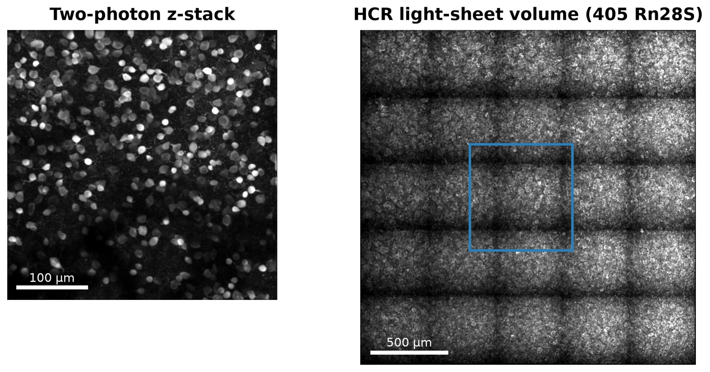
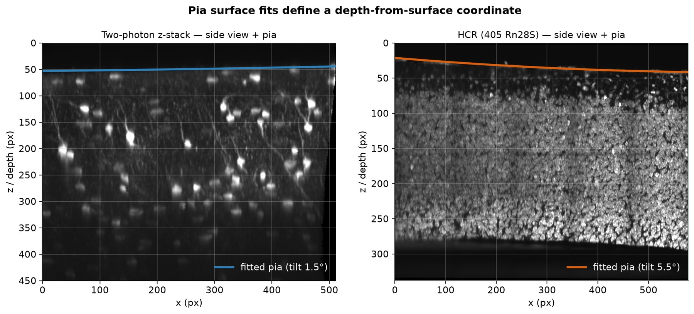
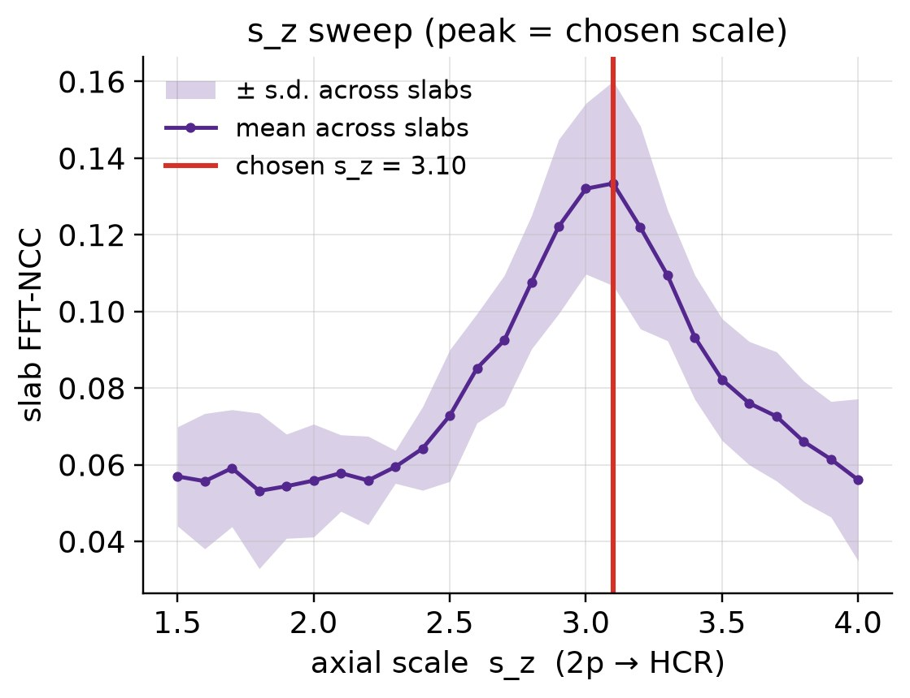
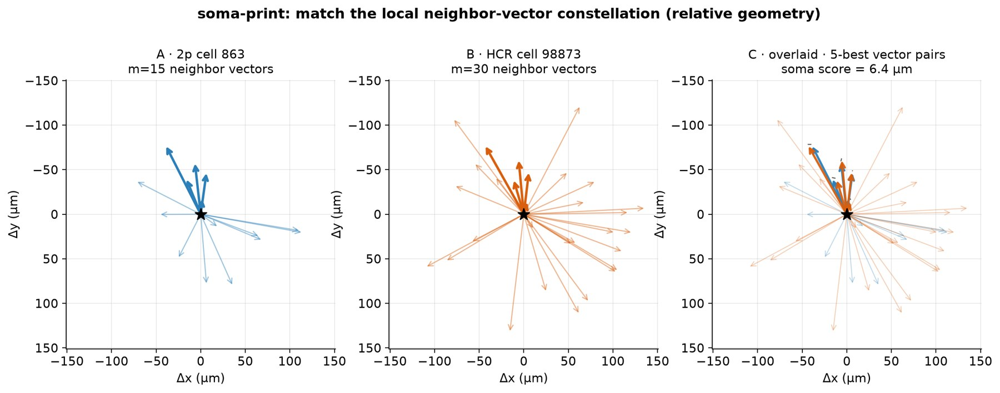
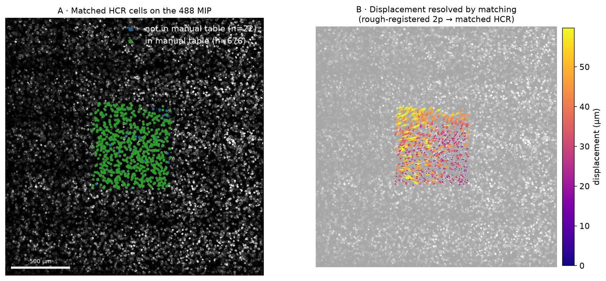
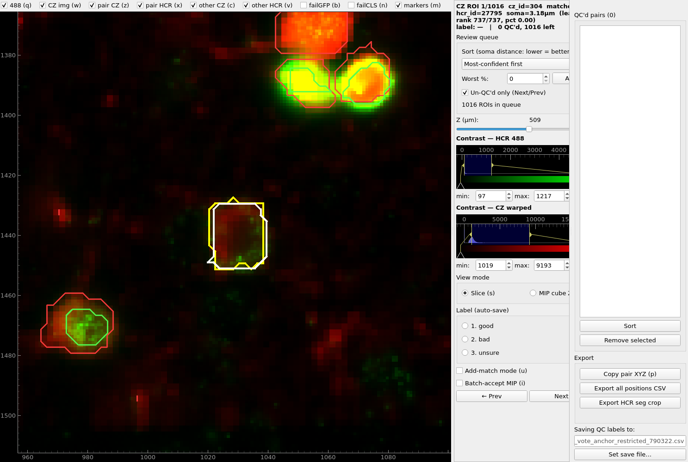

**Contributors**

- **Omid Zobeiri** — Development of the manual coregistration protocol.
- **Jazmin Campos** — HCR experiments.
- **Carson Berry & Matt J. Davis** — HCR data processing.

The goal of [Cell Types and Learning project](https://www.allenneuraldynamics.org/projects/cell-types-learning) at the Allen Institute, Neural Dynamics is to link neuronal function to gene expression. This requires accurately matching cells between in vivo functional imaging and ex vivo gene expression data. Traditionally, this was done manually, but the process is difficult to scale. This post is about automating that process.

---

## 1. The problem

We record the activity of the same set of neurons across multiple sessions, on average about 20, across 8 different depths in the primary visual cortex. The key to our study is to identify their transcriptomic profiles. We use intermediate in vivo two-photon z-stack imging to link between individual sessions and the final ex vivo HCR volume.

{#figure-1}

The two-photon z-stack covers roughly 400 × 400 x 400 µm of cortex. The HCR volume (cleared, expanded) is about
2.3 × 2.3 mm across and over a millimeter deep, with ~100,000 cells ([Figure 2](#figure-2)).

{#figure-2}

The following describes the main challenges in this multimodal coregistration ([Figure 3](#figure-3)): 

- **Unknown position and orientation.** The FOV is roughly targeted at the center of HCR sample (up to ~200 µm from the center of cleared, expanded tissue), and the patch can be rotated
  (typically ~180° in our setup) and tilted (typically up to ~15°).
- **Anisotropic expansion.** The clearing/expansion step enlarges tissue, and not equally in all
  directions. From our ground-truth landmarks, depth expands about 1.5× more than the lateral axes.
- **Non-rigid warping.** After the best possible global affine fit, cells are still off by 16–43 µm RMS
  (up to ~114 µm) — larger than a cell body.
- **Partial correspondence.** Many cells in one volume simply have no partner in the other
  (segmentation misses, cells that were out of the imaged range).

{#figure-3}
  
## 2. Manual coregistration 
**(Developed by Omid Zobeiri)**

The manual protocol, using BigWarp, goes like this:

1. Find a constellation of 4–6 cells near the surface of the 2p stack with a distinctive pattern.
2. Find the matching GFP-positive pattern in the HCR volume. Repeat until you are confident.
3. Set these as landmarks and apply a thin-plate-spline (TPS) transform.
4. Expand the set of landmarks with visual pattern matching. Until ~50–100 landmarks to cover the volume.
5. Use the current warp to propose cell-to-cell matches automatically, then go through *every*
   candidate by eye (shape, context, whether accepting it improves local agreement) and add the good ones
   as new landmarks. Repeat until nothing new appears.

It works, but it is laborious and requires steep learning curve, preventing scaling up. Only 2 people in our institute know how to do it well.

## 3. Test dataset

We used six subjects with manual ground truth, all with sparse
**pan-inhibitory** GCaMP expression (GCaMP in inhibitory neurons only).

Sparse is convenient: in the 2p stack, each labeled cell is isolated and bright, and in HCR we can find the
corresponding cells by their GFP signal. We call those **GFP+** cells, and the 2p ↔ HCR
correspondence lives almost entirely within that population.

Two supporting pieces made everything else possible:

- **An HCR ROI quality classifier.** The HCR segmentation has errors: merged cells, fragments, debris. A
  LightGBM classifier labels each 3-D ROI as good / bad-but-ok / bad / merged. It's trained
  on our own manual labels, uses 405-only features, and reaches a leave-one-subject-out binary AUC of ~0.92. The
  matcher only considers ROIs the classifier keeps — so it's a required dependency, not a nicety.
  Code: [capsule-3D-FISH-ROI-classifier](https://github.com/AllenNeuralDynamics/capsule-3D-FISH-ROI-classifier) (inference), [capsule-3D-FISH-ROI-labeling](https://github.com/AllenNeuralDynamics/capsule-3D-FISH-ROI-labeling) (interactive labeling), and [capsule-3D-FISH-ROI-classifier-training](https://github.com/AllenNeuralDynamics/capsule-3D-FISH-ROI-classifier-training) (training).
- **A GFP+ definition.** After comparing several options (including pairwise unmixing, which did *not*
  help), the most reliable was a Gaussian-mixture fit on the log of 488 spot density per cell.

## 4. Step 1: rough registration

The initial rough registration is image-based, classical computer vision approach. It required 4 main steps.

**(1) Surfaces.** We fit the pia (the top surface of the cortex) in both volumes. In each volume, the pia was fit using a 2-D polynomial over the intensity near the top part of the image. In HCR volume, we added iterative reweighted linear squares approach.This gives a common depth coordinate and the relative tilt (up to ~18° between the two). 
  
{#figure-4}

**(2) Lateral scale (s~xy~).** How much bigger does a cell look in HCR than in 2p? We estimated it by comparing the cross-sectional areas of corresponding ROIs (all ROIs in 2p volume, GFP+ ROIs in HCR volume). The median
cross-sectional area ratio of the ROIs, square-rooted, gave the lateral scale factor similar to the ground-truth value. Note that this approach cannot be used for estimating axial scale due to difference in z resolution between the two imaging modalities (step 4).

{#figure-5 width=60%}

**(3) Top-slab 2-D registration.** Take a slab beneath the pia from each volume, max-project, and
register the 2-D images — trying rigid, affine and piecewise-rigid models and keeping the best by
normalized cross-correlation against the raw 488 image. This step was devised from the experience with manual procedure - surface had sparse features for human to match easily, which turns out to be useful for automated procedure as well.

{#figure-6}

**(4) Axial scale (s~z~).** We took a side view of the tilt-matched 488 slab, swept s~z~, and found the
peak of the FFT-based correlation. Across the six benchmark subjects the peak matched the ground-truth
value exactly. 

{#figure-7 width=55%}

**Overlap crop.** With pose, scales and depth in hand, we only keep HCR cells that could possibly lie within
the 2p volume (plus a 10% margin) — cutting the search space roughly 7×. We made this a binding rule for every
later stage: *nothing operates outside the overlap crop.*

The output of Step 1 is not a final answer. In the ground-truth comparison it's still tens of
microns off in places. 

## 5. Step 2: matching cells with a "soma-print"

Soma-print, from [(Wang, Jiang, Sun et al., 2026)](https://www.biorxiv.org/content/10.64898/2026.04.28.719500v1.full.pdf), was the real breakthrough. Their approach (TRU-FACT) was to align in vivo and ex vivo imaging optically as much as possible, and to use soma-print as ROI matching quantification. Soma-print works great when the initial registration is reasonably accurate (this is the whole reason we needed step 1). 

The main idea in our work is to use this as a tool for nonrigid (fine) registration. Main updates in implementation are: (1) making it a 3D version ([Figure 8](#figure-8)), (2) additional filtering using mutual-best match, local flow coherence, and anchor vote ([Movie 1](#movie-1)) (3) incorporating it into an iterative refinement loop (inspired from the manual procedure).

{#figure-8}

### Filtering and iterative refinement loop
Soma-print is not a robust matcher when the modalities are not well-aligned (as opposed to how it was used in TRU-FACT). The following steps are designed to improve its reliability in our pipeline:

1. **Wide candidate radius.** For each 2p cell, consider all HCR cells within 150 µm — the best soma-print
   match is often *not* the nearest neighbor.
2. **Mutual-best.** Keep a pair only if each cell is the other's top choice.
3. **Round-0 local-flow filter.** In the first round only, drop pairs whose displacement disagrees with their neighbors'.
4. **Anchor vote.** Keep a pair only if at least 3 of its 5 soma-neighbors are also confidently matched.
5. **Fit, warp, repeat.** Fit a thin-plate spline to the accepted pairs, re-warp the 2p cells, and match again.
   Each round improves the warp, and new pairs appear at the edges. On the example subject: 667 → 692 → 698
   pairs, then it converges.
6. **Final polish.** After the loop converges, rebuild each 2p cell's descriptor from its 10 nearest **accepted pairs**, and pair all 2p cells again with the same filters. This added about 1.5% matches.

::: {#movie-1}
<video src="figures/mov_auto_4_matcher.mp4" controls preload="metadata" style="width:100%"></video>

**Movie 1.** The customized matcher on real cells: wide candidate search → mutual-best → local-flow filter → anchor vote → iterate with TPS. Use the player controls to pause and scrub.
:::

## 6. How well does it work?

Against our ground truth, **recall is 0.87–0.97** across the six subjects. A part of the loss is due to not having ROI quality filtering in the manual processing (which led to false positives). Precision
is more complicated: a number of the "false positives" look like genuine matches missed in the manual process. So our precision
numbers are a lower bound.

{#figure-9}

And here is the full result — the TPS-warped 2p stack overlaid on the HCR 488 volume, scrolling down from the pia:

::: {#movie-2}
<video src="figures/mov_auto_5_result.mp4" controls preload="metadata" style="width:100%"></video>

**Movie 2.** Final registration: 2p (magenta) over HCR 488 (cyan), with matched cells accumulating as gold circles. Use the player controls to pause and scrub.
:::

## 7. Manual QC

As a last step, we added a QC app.
It presents matches least-confident-first for pass/fail, lets you add or fix a pair manually with a
live re-warp, and exports the final coregistration table. The source repository of the QC app (a Code Ocean interactive capsule) is [interactive-capsule-2p-3DFISH-autocoreg-QC](https://github.com/AllenNeuralDynamics/interactive-capsule-2p-3DFISH-autocoreg-QC).

At least in the 6 subjects we tested, the automated algorithm worked well - manual correction was only at around 10 ROIs out of several hundred per subject.

{#figure-10} 

## 8. Miscellaneous Notes
- This protocol is now used in production in the Allen Institute, for projects across Brain Science and Neural Dynamics.
- The same approach was applied to other datasets with similar success (pan-neuronal GCaMP and Xenium - follow up posts).
- Prior experience with manual procedure was critical in giving insights to designing the automated pipeline. 
- Most of the pipeline was developed using Claude Code.
  - Initial attempt for asking the agent to figure out the solution failed. (Note: main development was done around May 2026.)
  - Image processing problem seems unique in a sense that a hallucination is easy to check visually. Producing intermediate images for each step helped catch errors early.
  - Making videos for explaining each step became much easier and fun. It helped communicate the process clearly to others.
- We are currently exploring the process to recover more matches (Being led by **Matt J. Davis**)
  - The current approach is ROI-to-ROI matching. This depends on the ROI detection quality. ROI detection in the structural z-stack seems to be the main bottleneck. The cause seems to be two-fold: (1) some inactive neurons during the structural z-stack acquisition, and (2) low SNR especially in deeper planes.
  - By directly registering FOV to HCR, we can recover more matches. We can do this by using chained transformations from FOV to zstack and zstack to HCR. 

**[→ Part 2: pan-neuronal](../2026-10-auto-coregistration-2-pan-neuronal/index.qmd)**

---

*Code: [github.com/jkim0731/2p2fish](https://github.com/jkim0731/2p2fish) (the `autocoreg` package) and
[github.com/jkim0731/mfish-roi-classifier](https://github.com/jkim0731/mfish-roi-classifier).*

