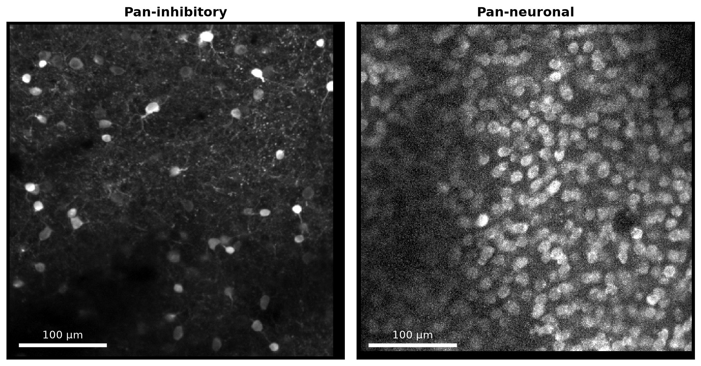
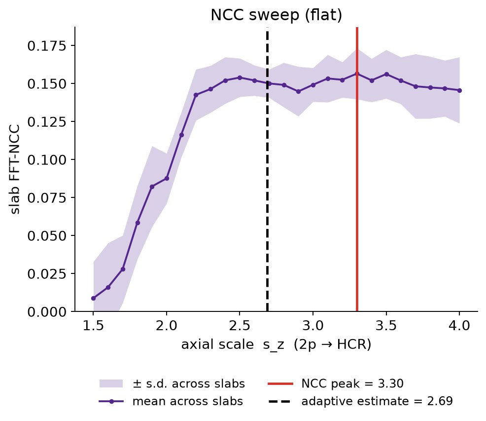
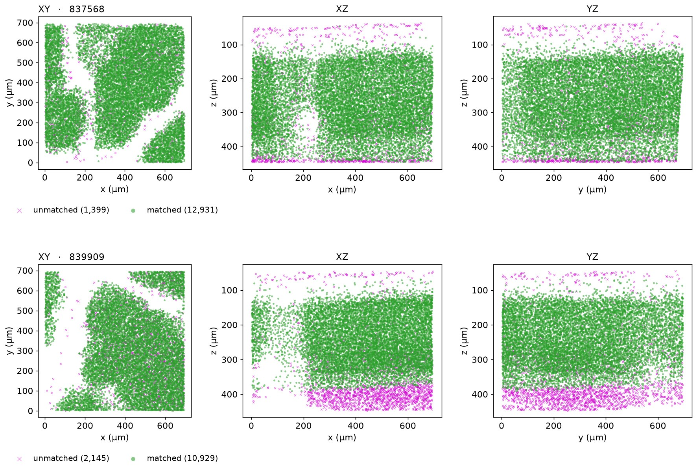

In [Part 1](../2026-10-auto-coregistration-1-pan-inhibitory/index.qmd) the pipeline was built and tested on pan-inhibitory samples. Here I apply it to pan-neuronal samples, where GCaMP is expressed in essentially all neurons. This post covers what had to change.

---

## 1. Pan-inhibitory vs pan-neuronal

Within the same 400 x 400 x 400 um volume, there are about 1,000 ROIs in the 2p stack of a pan-inhibitory sample, and about 13,000 ROIs in the 2p stack of a pan-neuronal sample ([Figure 1](#figure-1)).

{#figure-1}

**GFP+ filtering is not needed.** For pan-inhibitory samples, GFP+ filtering is necessary to balance the number of candidates between the modalities. For pan-neuronal, that is not necessary anymore: although not all Rn28S+ ROIs have a 2p partner (non-neuronal cells, losing 2p ROIs from vasculature shadows), the density imbalance was small enough to allow using soma-print for matching reliably. Within the bounding box of the final matches, there are 26,789 HCR ROIs (kept by the quality classifier) for 13,074 2p ROIs in 839909, and 30,615 for 14,330 in 837568, about two HCR ROIs per 2p ROI.

## 2. Problems with dense data

Dense expression breaks two parts of the Part 1 pipeline. Both come from the same property: with about 10 times as many cells, a local cell arrangement is much less unique.

**Axial scale.** In Part 1, s~z~ was the peak of an FFT-based correlation between the 2p stack and a side view of the HCR 488 slab. In the dense data the side view is nearly uniform with depth, so the correlation has little to lock onto and plateaus ([Figure 2](#figure-2)). For an example subject 839909 the peak is just 1.06 times the median (we require 1.10), and its position, 3.30, is far from the value the matched pairs give (2.69).

{#figure-2 width=70%}

**False positives, mostly at depth.** Soma-print compares the arrangement of the nearest neighbors. With dense cells, a wrong partner is much more likely to have a similar-looking neighborhood. This gets worse with depth, for three reasons:

1. **More HCR cells without a 2p partner.** 2p detection falls with depth (lower SNR), while HCR density does not. In 839909 there are 2.2–2.3 HCR ROIs per 2p ROI in the upper-middle of the overlap, and 2.7–3.0 in its deepest 200 µm. Each extra HCR cell is another look-alike candidate, and the 2p neighborhoods are more incomplete.
2. **Fewer anchors.** The fraction of 2p ROIs matched is 0.96–0.98 between 100 and 250 µm in the 2p stack, 0.87 at 300–350 µm and 0.49 at 350–400 µm. Few anchors at the bottom means the warp there is weakly constrained, and the stack ends beyond the last anchors (section 4).
3. **Axial scale error grows with depth.** An error in s~z~ is a position error proportional to depth below the pia. The seed for 839909 (2.90) is 0.21 above the final value (2.69), which is 13 µm at 60 µm below the pia and 63 µm at 300 µm. A misaligned neighborhood is less likely to match its true partner, and more likely to match a look-alike.

Section 3 addresses the first problem and section 4 the second.

## 3. Axial scale (s~z~)

I replaced the sweep with a two-pass estimate:

1. **Seed.** s~z~ = HCR layer 1 thickness / 2p layer 1 thickness. Layer 1 has few cells, so the depth where cell density starts to rise marks the L1/L2 boundary in both volumes ([Figure 3](#figure-3), panels 1–4). For 839909: 171 µm / 59 µm = 2.90.
2. **Pass 1.** Run the matcher with the seed.
3. **Regression.** Fit the slope of HCR depth vs 2p depth through the origin, using matched pairs deeper than 30 µm below the pia. This slope is s~z~ ([Figure 3](#figure-3), panel 5).

**L1/L2 boundary from cell density.** In each volume, the ROI centroids are binned by depth and the histogram is smoothed. In the 2p stack the depth is measured from a tilted plane fitted to the tissue (4 µm bins; the tilt that gives the sharpest rise is chosen). In HCR the depth is measured below the pia fitted to the image (6 µm bins, GFP+ ROIs). The steepest rise of the histogram lies inside L2, so starting from there I walk toward the surface until the gradient falls below 25% of its peak; that depth, the foot of the rise, is the L1/L2 boundary. L1 thickness is the boundary minus the pia ([Figure 3](#figure-3), panels 1–4).

{#figure-3}

The seed only has to be good enough to produce matches over a couple hundreds of microns in 2p zstack in the first pass.

## 4. TPS constraint and iteration

The matcher is the same as in Part 1: match, fit a TPS to the accepted pairs, re-warp the 2p cells, repeat. In the first pan-neuronal subject (837568), one deep part of the stack was warped much more than the rest.

The cause is extrapolation. A thin-plate spline fit to the accepted pairs (the anchors) is reliable only inside the region the anchors span. Outside it, the TPS extrapolates, and the extrapolation can shift cells by a large amount. The deepest 2p cells lie just outside that region (few anchors there, section 2), so they were shifted together as one block. As noted in section 2, dense cells make a false-positive group more probable: the shifted block still finds neighbors with similar spacing, so it passes the soma-print and anchor-vote checks (they compare the arrangement of neighbors, not absolute position), and the next TPS fit locks it in. This was not a problem with the sparse pan-inhibitory subjects. The local-flow filter, which would flag it, runs only in round 0.

Two changes fix this:

1. **Bounded TPS.** Inside the anchor hull the warp is the exact TPS. Outside it, after a 50 µm margin, the warp blends into a robust global affine fit over 40 µm.
2. **Support gate.** A candidate whose 2p position lies outside the hull of the previous round's accepted anchors (plus 150 µm) cannot become an anchor. In 839909 this removed 62, 500 and 462 candidates in rounds 0, 1 and 2.

Nothing changes inside the hull. When tested this update on the six pan-inhibitory subjects, five gave identical recall and one differed by a single pair (largest recall change 0.003).

**Iteration.** The iteration process is the same as for sparse sample (pan-inhibitory; [Part 1](../2026-10-auto-coregistration-1-pan-inhibitory/index.qmd)). However, the final polish step described in Part 1 added 974 pairs (9,955 → 10,929), 10% of the pairs, compared to 1.5% in the pan-inhibitory subjects.

## 5. Result

In 839909, 10,929 of 13,074 2p ROIs are matched (84%); in 837568, 12,931 of 14,330 (90%). The unmatched ROIs are mostly at the shallowest (mostly due to bad HCR ROI quality) and deepest parts of the stack (mostly due to bad 2p ROI detection from low SNR) ([Figure 4](#figure-4), [Movie 1](#movie-1), [Movie 2](#movie-2)). There is no manual ground truth for these subjects, so the results were checked visually.

{#figure-4}

::: {#movie-1}
<video src="figures/837568_sweep_rois_topdown.mp4" controls preload="metadata" style="width:60%"></video>

**Movie 1.** 837568, final registration: warped 2p ROIs swept top-down through the HCR volume. Use the player controls to pause and scrub.
:::

::: {#movie-2}
<video src="figures/839909_sweep_rois_topdown.mp4" controls preload="metadata" style="width:60%"></video>

**Movie 2.** 839909, final registration, same display as Movie 1.
:::

---

*Code: [github.com/jkim0731/2p2fish](https://github.com/jkim0731/2p2fish).*
